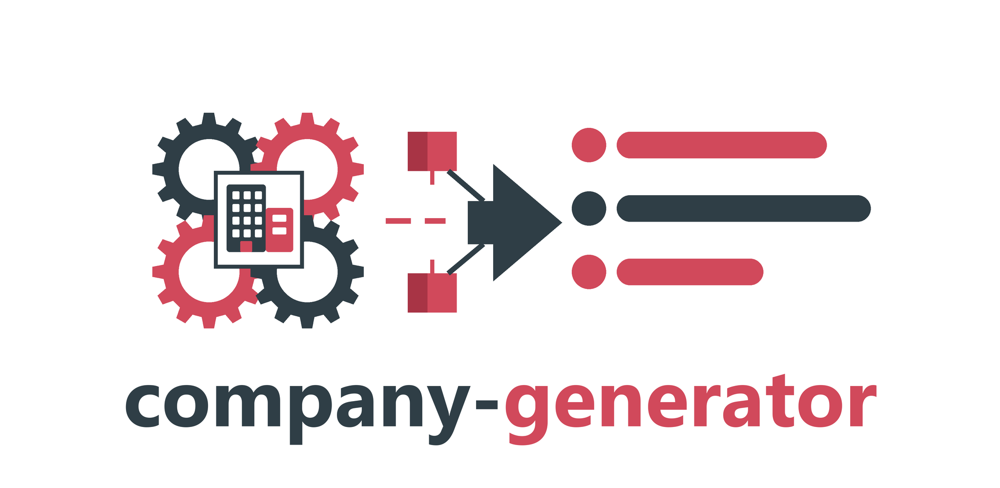

# Company Generator for C++

> **Requires C++23** (e.g., `-std=c++23` for GCC/Clang, `/std:c++latest` for MSVC).

[](https://github.com/dasmig/company-generator/releases)

[](https://raw.githubusercontent.com/dasmig/company-generator/main/LICENSE.MIT)
[](https://github.com/dasmig/company-generator/actions/workflows/ci.yml)
[](https://github.com/dasmig/company-generator/releases)
[](https://en.cppreference.com/w/cpp/23)
[](https://github.com/dasmig/company-generator#integration)
[](https://dasmig.github.io/company-generator/)

**[API Reference](https://dasmig.github.io/company-generator/)** · **[Usage Guide](doc/usage.md)** · **[Data and Method](doc/data.md)** · **[Releases](https://github.com/dasmig/company-generator/releases)**

Companies that fit their country: industry, size and head count, legal form, founding date, name, registration numbers and domain, for all 199 countries, drawn from business statistics and whole business registers.

```
DE, Fotografie Schmidt e. K., 2 persons, USt-IdNr. DE296418727, fotografieschmidt.example
FR, Distillerie Robert, 2 persons, SIREN 968 256 796, SIRET 968 256 796 00015, TVA FR50 968256796, distillerierobert.example
GB, Jones Estates Ltd, 3 persons, CRN 61435276, VAT GB337 1995 31, jonesestates.example
JP, 株式会社テクノプラス, 34 persons, 法人番号 2096701617945, technoplus.example
BR, Corretora Express Ltda., 1 person, CNPJ 85.422.227/0001-38, LEI ZZZZH63KRHW42AVHTX97, corretoraexpress.example
RU, ООО «СтройМир», 2 persons, ОГРН 1251160853974, ИНН 1120771389, stroymir.example
US, Hernandez Analytics LLC, 1 person, EIN 08-2999208, hernandezanalytics.example
```

These examples use `safe`, so no company holds their numbers or domains.

## Limits

- Realistic numbers, the default, pass their check digits and lie in the issued range, so they may belong to a real company. Use `safe` for anything that leaves a test environment.
- Names are made of common surnames and trade words, so a name can coincide with a real firm's ("Müller Bau GmbH"). `safe` changes numbers and domains, not names.
- The library looks nothing up and cannot tell whether a company, number or domain exists.
- It draws registered businesses. Where most firms are informal, the economy has many more than the register counts.

## Features

- **Country-true Companies**. The industry, size, legal form and age of a company follow the statistics of its country (199 served): Eurostat, the OECD, ILOSTAT, the US Census Bureau, national economic censuses, and the whole business registers of the UK, France and Norway. Every company says how well its fields are known (`measured`, `modelled`, `filled`), and `doc/data.md` lists the source of each field by country.

- **Names in the Country's Languages**. Names in each country's business-name languages and scripts, from trade words read by hand for 38 languages, with the legal form written the local way: "Fotografie Schmidt e. K.", "ООО «СтройМир»", "株式会社テクノプラス", "Restaurante de Levante S.L.". A sole trader's name never names a partner ("& Co."). A founder surname or place you pass in is used where it fits.

- **Valid Registration Numbers**. 63 register, tax, VAT and LEI schemes in 47 countries, each passing its check digits and encoding what the real one encodes (the RFC's founding date, the SIREN inside the SIRET), checked against python-stdnum on 100,000 numbers per scheme. `is_valid()` checks numbers of your own.

- **Safe Mode**. Numbers no company holds (wrong check digits, reserved prefixes, above the highest issued) and `.example` domains, for test data that leaves the test environment. A scheme with no safe method is left out.

- **Forced Fields**. Ask for a country, industry, size, head count or legal form, or pass an occupation to draw the industry of a worker in it; the rest is drawn to fit, and a request no company can meet throws.

- **Deterministic Seeding**. Per-call `get_company(request, seed)` for reproducible results, and `company::seed()` for replaying a previous generation with the same request and data.

- **Batch Generation**. Generate thousands of results from one seed, on several threads with the same output for any thread count, optionally unique by a key, and stream them as JSON Lines or CSV (see the usage guide).

- **Identical Everywhere**. A seed gives the same result on every compiler, standard library and CPU (GCC, Clang, MSVC, Emscripten; x86-64 and ARM64), checked by known-answer tests.

- **Extensible Data**. Load your own TSV layers on top of the shipped data to add, change or remove entries (`extend()`), checked before they are applied.

- **JSON and Replay**. `to_json()` on every result, and a `signature()` recording the seed and the data it came from.

- **Compiled-in Data**. Define `DASMIG_COMPANY_EMBED` to build the `lite` tier into the program, for WebAssembly and other builds without files.

- **Multi-Instance Support**. Construct independent `cpg` instances with their own data and random engine.

## Integration

[`companygen.hpp`](https://github.com/dasmig/company-generator/blob/main/dasmig/companygen.hpp) is the library [released here](https://github.com/dasmig/company-generator/releases). Keep [`core.hpp`](https://github.com/dasmig/company-generator/blob/main/dasmig/core.hpp) and the [`core/`](https://github.com/dasmig/company-generator/tree/main/dasmig/core) directory ([dasmig-core](https://github.com/dasmig/dasmig-core)) in the same directory. Add

```cpp
#include <dasmig/companygen.hpp>
```

to the files you want to use it in, and supply the [`resources`](https://github.com/dasmig/company-generator/tree/main/resources) folder (or define `DASMIG_COMPANY_EMBED`).

## Usage

```cpp
#include <dasmig/companygen.hpp>
#include <iostream>

auto& gen = dasmig::cpg::instance(); // loads the lite tier

auto v = gen.get_company(dasmig::company_request{}, 33); // the same seed gives the same result everywhere
std::cout << v << '\n';           // ES, Restaurante de Levante S.L., food and beverage service activities (56), 2 persons, founded 2025-06-28
std::cout << v.to_json() << '\n'; // {"country_code":"ES","name":"Restaurante de Levante S.L.",...,"numbers":[{"scheme":"es-nif-entity","label":"NIF","value":"B14864508",...}],"domain":"restaurantedelevante.es",...}

// Force what you need; the rest is drawn to fit.
dasmig::company_request r;
r.country = "FR";
r.isic = "F";                     // construction
r.size = dasmig::size_band::small;
r.incorporated_only = true;
auto builder = gen.get_company(r, 5);
std::cout << builder << '\n';     // FR, Bâtiment Pereira SAS, specialized construction activities (43), 39 persons, founded 2009-12-26
builder.numbers;                  // SIREN 512 388 430, SIRET 512 388 430 00013, TVA FR94 512388430

r.safe = true;                    // numbers nobody holds, .example domains
auto test_only = gen.get_company(r, 5);
test_only.numbers;                // SIREN 512 388 435, ... each marked reserved
test_only.domain;                 // batiment-pereira.example

// Or any company at all: the country by its enterprises, then everything else.
auto anyone = gen.get_company(dasmig::company_request{});

gen.is_valid("fr-siren", "552 100 554"); // true
gen.is_valid("fr-siren", "552 100 555"); // false
```

See the [usage guide](doc/usage.md) for everything else.

## Building

```bash
make            # example
make test       # tests
make bench      # benchmarks, results in build/bench.tsv
make test-embed # tests with the lite tier compiled in
make coverage   # code coverage
make lint       # clang-tidy
make docs       # API docs
make embed      # regenerate dasmig/companygen_data.hpp from resources/lite
```

## Compiler Support

Tested with:
- Clang 18+ (`-std=c++23`)
- GCC 14+ (`-std=c++23`)
- MSVC 19.38+ (`/std:c++latest`)
- Emscripten 3.1.74

## Dependencies

| Dependency | Version | Bundled | Purpose |
|-----------|---------|---------|---------|
| [dasmig-core](https://github.com/dasmig/dasmig-core) | 1.4 | Yes (`core.hpp`, `core/`) | Platform-independent random engine and distributions, check digits, patterns, data layers, JSON |
| [Catch2](https://github.com/catchorg/Catch2) | 3.x | Yes (amalgamated) | Unit testing |

## Data

Statistics from Eurostat, the OECD (CC BY 4.0), ILOSTAT (CC BY 4.0) and the US Census Bureau (public domain), counts and word statistics from the business registers of the UK (Open Government Licence v3.0), France (Licence Ouverte 2.0) and Norway (NLOD 2.0), legal forms and LEI issuers from GLEIF (CC0), and places from GeoNames (CC BY 4.0). No real firm's name or number is shipped. See [doc/data.md](doc/data.md) and [LICENSE_DATA.txt](LICENSE_DATA.txt).

## Related Libraries

| Library | Description |
|---------|-------------|
| [address-generator](https://github.com/dasmig/address-generator) | Postal addresses with real streets by place |
| [biodata-generator](https://github.com/dasmig/biodata-generator) | Procedural human physical characteristics |
| [birth-generator](https://github.com/dasmig/birth-generator) | Demographically plausible birthdays |
| [city-generator](https://github.com/dasmig/city-generator) | Weighted city selection by population |
| [country-generator](https://github.com/dasmig/country-generator) | Weighted country selection by population |
| [device-generator](https://github.com/dasmig/device-generator) | Devices, browsers, user agents and IP addresses that fit together |
| [email-generator](https://github.com/dasmig/email-generator) | Email addresses in each country's style |
| [entity-generator](https://github.com/dasmig/entity-generator) | ECS-based entity generation |
| [finance-generator](https://github.com/dasmig/finance-generator) | Bank accounts and payment cards in each country's form |
| [id-generator](https://github.com/dasmig/id-generator) | National identity numbers, passports and identity cards that fit a person and a date |
| [interest-generator](https://github.com/dasmig/interest-generator) | Religion, hobbies and favourite media by country, age and sex |
| [name-generator](https://github.com/dasmig/name-generator) | Culturally appropriate full names |
| [nickname-generator](https://github.com/dasmig/nickname-generator) | Gamer-style nicknames |
| [occupation-generator](https://github.com/dasmig/occupation-generator) | Employment status, education and occupation by country, age and sex |
| [persona-generator](https://github.com/dasmig/persona-generator) | Complete characters composed from the other generators |
| [phone-generator](https://github.com/dasmig/phone-generator) | Phone numbers valid in each country's numbering plan |
| [property-generator](https://github.com/dasmig/property-generator) | Homes that fit a household: dwelling type, tenure, rooms, size, age and cost |
| [relationship-generator](https://github.com/dasmig/relationship-generator) | Families around a person: parents, siblings, partners and children |
| [trait-generator](https://github.com/dasmig/trait-generator) | Personality traits with conflicts, synergies and Big Five axes |
| [user-generator](https://github.com/dasmig/user-generator) | Complete user records: account, username, email, phone and address |
| [vehicle-generator](https://github.com/dasmig/vehicle-generator) | Cars and motorcycles with plates and VINs that fit their country and date |
| [weather-generator](https://github.com/dasmig/weather-generator) | Daily weather for any place on land and any date |

## License

This library is released under the [MIT License](https://opensource.org/licenses/MIT).

```
MIT License

Copyright (c) 2026 Diego Dasso Migotto
```
